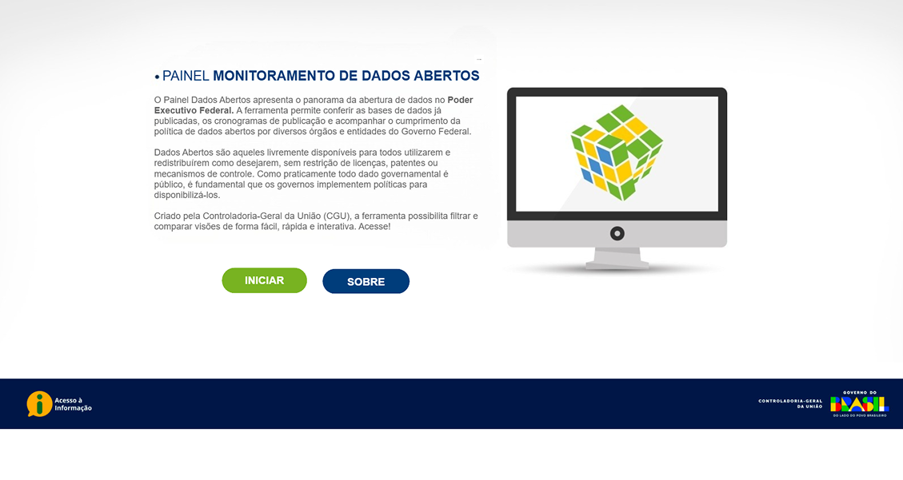
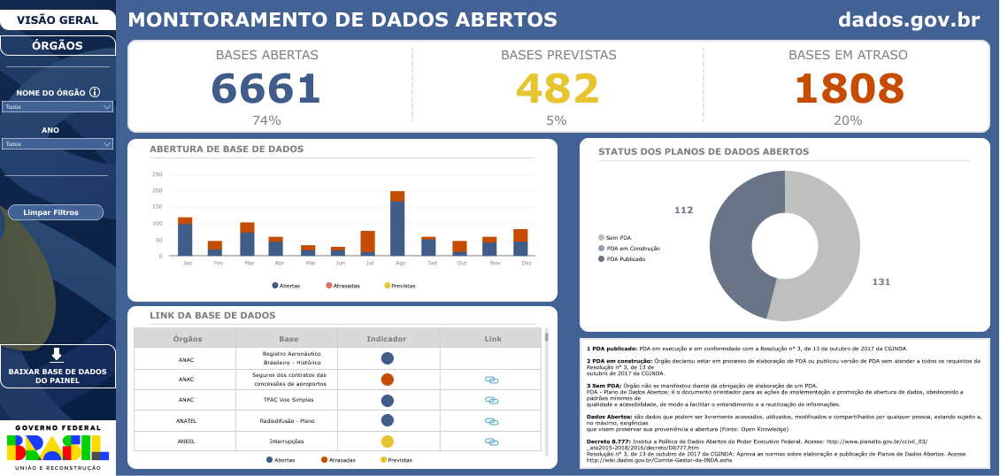
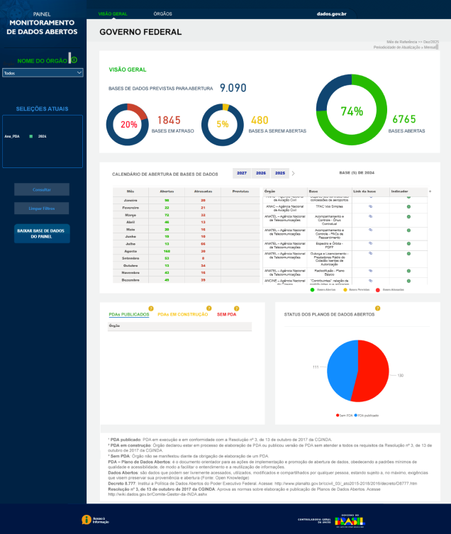

# Redesign UI/UX - Dashboard de Dados Abertos (GOV)

Exercício de **UI/UX para visualização de dados**, focado no redesign visual do dashboard de [Monitoramento de Dados Abertos](https://centralpaineis.cgu.gov.br/visualizar/dadosabertos)

## Contexto
Dashboards de dados públicos costumam ser ricos em informação, mas nem sempre realmente oferecem uma boa experência de usuário na navegação e leitura e fiz do painel gov um bom exemplo.
Esse micro projeto teve como objetivo repensar **exclusivamente a camada visual** porém mantendo o conteúdo original do dashboard. 

## Objetivo 
* Melhorar a hierarquia das informações.
* Tornar a leitura e identificação dos dados mais claros.
* Modernizar a interface.
* Aplicar práticas de UI/UX para dashboard em dados. 

## Ferramenta
Uso FIGMA para construção total do redesign. 

## Conclusão
A página inicial original não apresentava destaque nas informações textuais (informativo e botões), tinha uma tela de fundo "morta" e sem constraste além de apresentar muito espaço em branco desnecessário, melhoramos isso trazendo uma tela de fundo com formas mais despojadas trazendo a atenção do usuário para o principal, o texto informativo que agora também apresenta um formato orgânico de fundo e realça o constraste. Os botões foram aumentados e aplicamos um leve degradê na sua coloração além de um efeito de sombra mais profundo para despertar a ação do usuário.

Já a página principal oficial além de apresentar um formato um tanto quanto diferente do padrão utilizado para dashboards também é possível notar 3 gráficos de rosca diferentes que representam a porcentagem de cada situação das bases, uma escolha redundante, além de novamente apresentar diversos espaços em brancos desnecessários entre outras escolhas não tão bem estruturadas. 
Na nossa versão temos um destaque maior para os valores totais da situação de cada base e que também traz a porcentagem do total, alteramos a barra de navegação lateral para combinar com a página inicial e deixamos as opções com maior contraste para leitura. Reorganizamos o posicionamento dos gráficos e optamos por utilizar gráficos de barras para a abertura das bases, indicando de maneira mais direta a diferença entre as quantidades.

## Comparação visual 

### Redesign - Página Inicial

## Página Oficial (GOV)

### Redesign - Página Principal 

### Página Oficial (GOV)

## Observações 
* Esse é um projeto 100% **pessoal e não oficial**
* A diferença de valores se da pela atualização dos dados GOV que não ocorreram no redesign pois não foi utilizado ligação com os dados. 
* Foco exclusivamente visando facilitar a experiência do usuário.
* As telas originais pertencem ao Governo Federal 